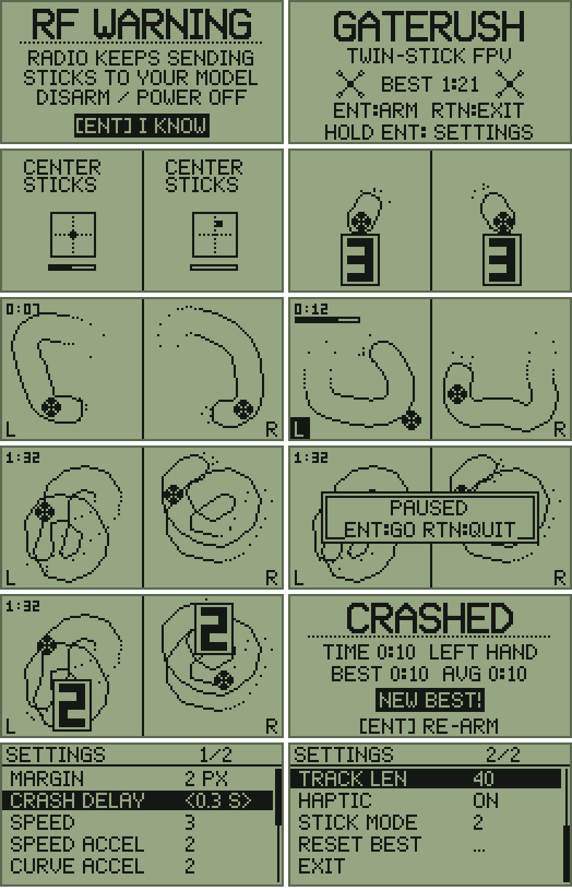

# GateRush

A twin-stick FPV warm-up game for **EdgeTX radios with a 128×64 black & white screen** (Radiomaster TX12 /
TX12 MK2 / Boxer / Pocket / GX12 / Zorro, Jumper T-Pro / T-Lite / T20 — the `PCB=X7` family).

Each stick flies one quad, seen from above, through its own tunnel. The left stick owns the left half of the
screen, the right stick the right half. The stick position *is* the quad position. The tunnels keep winding
and the tail keeps chasing you; leave a tunnel (or let the tail catch you) for too long and you crash.
Score = time alive.



## Install

1. Copy `dist/SCRIPTS/TOOLS/gaterush.lua` **and the folder** `dist/SCRIPTS/TOOLS/GATERUSH/` to `/SCRIPTS/TOOLS/`
   on the radio's SD card:

   ```
   SD card
   └── SCRIPTS/TOOLS/
       ├── gaterush.lua
       └── GATERUSH/          <- saves (settings and best times) go here
   ```
2. On the radio: **SYS** → **TOOLS** → **GateRush**.

The first launch compiles the script (a `gaterush.luac` appears next to it); give it a second.
Without the `GATERUSH/` folder the game still works, with default settings and no records: the title then
shows **NO SAVE** instead of "TWIN-STICK FPV".

## RF warning

The radio **keeps transmitting your sticks to the bound model while you play**. The first screen says so
(with the current model's name): disarm, or better, power the model off, before pressing ENT.

## Controls

| where | key | action |
|---|---|---|
| RF warning | ENT | I know, continue · RTN quits |
| title | ENT | arm (go to CENTER STICKS) |
| title | hold ENT | settings |
| title | RTN | exit the script |
| center sticks | — | hold all four axes within ±8 % for 0.5 s (both bars full) → 3-2-1 countdown |
| play | RTN | pause |
| pause | ENT | resume: 3 s countdown; the game is frozen but the quads move, so put them back in the tunnels |
| pause | RTN | give up (goes to CRASHED, not counted as a record) |
| crashed | ENT | re-arm (CENTER STICKS) · RTN back to the title |
| settings | roller / PAGE keys | move; ENT edits the selected value (shown as `<value>`), roller/PAGE change it, ENT or RTN stop editing; RTN leaves and saves |

Throttle sticks usually have no spring: center it by hand on CENTER STICKS.

## How a run works

- Tunnels spawn at the center of each half, straight and slow. For the first 1.5 s after GO nothing counts as out.
- You are **out** when the quad's **center** leaves the tunnel (more than the tunnel radius from its centerline),
  or when the tail end passes your quad. While out: the quad blinks with the crash sprite, the `L`/`R` corner
  lights up, a 300 Hz beep + short vibration play every 250 ms and a bar under the timer runs down.
  Get back in before it empties and everything resets; otherwise **CRASHED** (cause: LEFT HAND, RIGHT HAND or TAIL).
- The head speeds up and the maximum curvature grows with time alive (no levels).

## Settings

| setting | range | default | effect |
|---|---|---|---|
| MARGIN | 0–5 px | 2 | tunnel radius = 4 + MARGIN; the stick travel is re-mapped so the whole tunnel area is reachable |
| CRASH DELAY | 0.0–2.0 s | 0.3 | time allowed out of the tunnel (0 = instant crash) |
| SPEED | 1–5 | 3 | starting head speed: 0.8 / 1.1 / 1.5 / 2.0 / 2.6 px per 50 ms |
| SPEED ACCEL | 0–5 | 2 | speed growth per minute alive: 0 / 45 / 90 / 135 / 180 / 240 % |
| CURVE ACCEL | 0–5 | 2 | max-curvature growth per minute, same table |
| TRACK LEN | 20–80, step 5 | 40 | tunnel length in points (one point per 50 ms: 40 = 2 s of tunnel) |
| HAPTIC | ON/OFF | ON | vibration when out |
| STICK MODE | 1–4 | radio's mode on EdgeTX 3.0+, else 2 | which sticks drive which half (set it to your radio's stick mode) |
| RESET BEST | — | — | ENT, then ENT again (`ENT?`) clears the record of the current configuration |
| EXIT | — | — | save and back to the title |

Settings are saved to `/SCRIPTS/TOOLS/GATERUSH/gaterush.cfg` when leaving the menu; a missing or broken file
just means defaults.

## BEST and AVG

Records are kept **per difficulty configuration**: MARGIN, CRASH DELAY, SPEED, SPEED ACCEL, CURVE ACCEL and
TRACK LEN form a key (e.g. `m2d3s3a2c2t40`). Changing any of them shows the BEST of that configuration
(`BEST --:--` when it has none yet). HAPTIC and STICK MODE do not split the records. AVG is the average of all
finished runs with that configuration. Stored in `/SCRIPTS/TOOLS/GATERUSH/gaterush.dat`.

## Development

Sources live in `src/` (one module per file, `require` in development); `tools/build.lua` inlines them into the
single `dist/SCRIPTS/TOOLS/gaterush.lua`. `dist/` is laid out like an SD card.

Needs Lua 5.2 (`lua5.2`, `luac5.2`; on Windows the LuaBinaries `lua52.exe` works: `make LUA=lua52 LUAC=luac52`)
and Python 3 with Pillow for PNG output.

| command | what |
|---|---|
| `make build` | build `dist/SCRIPTS/TOOLS/gaterush.lua` and syntax-check it |
| `make test` | build + all tests (`tests/run_all.lua`): draw, config, stats, input, track, rules, 12 screen goldens (src and dist) |
| `make frames` | run every `inputs/*.lua` scenario (≥ 600 frames) on the mock, PBM frames + `metrics.json` in `out/` |
| `make soak` | the bad bot plays 100 games in a row: no errors, ≤ 300 draw calls, flat memory |
| `make calibrate` | bot survival times (see `docs/TUNING.md`) |
| `make sim SIMU_DLLS=<dir> RADIO=tx12` | Level 2: run the game in the **real EdgeTX firmware** and compare with the mock |
| `make lint` | luacheck (if installed) + "no global writes" check of the built file |

### How testing works

1. **Mock** (`tools/mock/`): the B&W `lcd.*`, `getValue`, `getTime`, `playTone`, `playHaptic`, `io.*` API,
   pixel-exact with the firmware (XOR default, opaque proportional fonts decoded from the firmware, line patterns
   on absolute coordinates). Unknown globals, B&W-missing functions (`lcd.drawCircle`…), negative or off-screen
   coordinates, and global writes raise errors. Inside the script, `table`, `os` and string methods are removed,
   as on the radio. `tools/run_frames.lua` steps the game 50 ms per frame with scripted sticks/keys.
2. **Golden masters** (`tests/golden/*.pbm`): the last frame of each `inputs/NN_*.lua` scenario. To approve a new
   golden after an intended visual change: `APPROVE=1 lua5.2 tests/run_all.lua test_screens`, then look at
   `out/screens/*.pbm` (`python tools/snapshot.py png out/screens/x.pbm x.png`) before committing. A failing
   golden writes a red/blue diff PNG to `out/screens/`.
3. **Level 2 — real firmware** (`tools/simhost/`): drives the EdgeTX Companion simulator DLLs (real firmware
   compiled for PC) from Python `ctypes`, launches the tool from SYS → TOOLS, injects sticks/keys, saves the
   LCD as PBM. `compare.lua` then checks that the mock draws exactly the same pixels. Setup in
   `tools/simhost/README.md` (Windows x64; the DLLs come from the Companion installer, nothing to install).
4. **Level 3 — Companion simulator (you)**: install EdgeTX Companion, create a radio profile for your radio
   (e.g. TX12), set its **SD structure path** to this repo's `dist/` folder, start the simulator, then
   SYS → TOOLS → GateRush. The stick mode is set in the radio profile (Radio settings → Mode) and inside the
   simulated radio (SYS → Radio setup); match the game's STICK MODE to it. The camera icon in the simulator
   window saves a screenshot. CLI: `simulator --radio tx12 --sd-path ./dist` (name/flags vary by version).

### Layout

```
src/        config, stats, draw, input, track, fx, game, screens, main
tools/      build.lua, harness.lua, run_frames.lua, bot.lua, calibrate.lua, soak.lua, snapshot.py,
            mock/ (API mock, framebuffer, firmware fonts), simhost/ (real firmware host)
tests/      test_*.lua, golden/
inputs/     deterministic scenarios (one per screen + perf_worst)
docs/       DECISIONS.md, TUNING.md, PERF.md, REPORT.md, research/, screens/
dist/       SD card image (generated, committed so it can be copied directly)
```

## Tested radios

| radio | mock (level 1) | real firmware 2.12.4 on PC (level 2) | real radio (level 3) |
|---|---|---|---|
| TX12 | ✓ all tests | ✓ play, settings, pixel-identical to the mock on 7 screens | not yet |
| TX12 MK2 | (same target) | ✓ 300 frames, no errors | not yet |
| Boxer | (same target) | ✓ 300 frames, no errors | not yet |
| Pocket | (same target) | ✓ 300 frames, no errors | not yet |
| GX12 | (same target) | ✓ 300 frames, no errors | not yet |

## License

MIT, see `LICENSE`.
